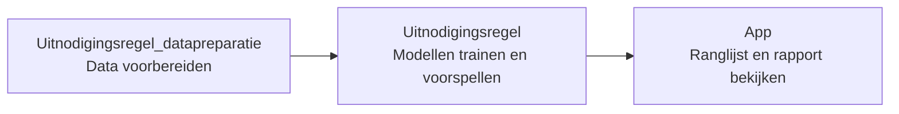

# Aan de slag

## Overzicht

De Uitnodigingsregel bestaat uit drie stappen:



Je kunt de app direct uitproberen met de meegeleverde synthetische demo-data. Voor gebruik met eigen data heb je twee bestanden nodig, zie [Je data aanleveren](data-aanleveren.md).

## Installatie

=== "Windows (Scoop)"

    Installeer [Scoop](https://scoop.sh) en voer daarna uit in PowerShell:

    ```powershell
    scoop bucket add uitnodigingsregel https://github.com/cedanl/Uitnodigingsregel
    ```

    ```powershell
    scoop install uitnodigingsregel
    ```

=== "Handmatig (Windows, macOS, Linux)"

    1. Installeer [uv](https://docs.astral.sh/uv/getting-started/installation/).
    2. Haal de repository op:

        ```
        git clone https://github.com/cedanl/Uitnodigingsregel.git
        ```

    3. Installeer de dependencies in de map van de repository:

        ```
        uv sync
        ```

Voor het rapport over modelkwaliteit is daarnaast [Quarto](https://quarto.org/docs/get-started/) nodig. Zonder Quarto werkt de app, maar kun je geen rapport maken.

## De app gebruiken

1. Start de app.

    === "Windows (Scoop)"

        ```powershell
        uitnodigingsregel --open
        ```

    === "Handmatig"

        ```
        uv run uitnodigingsregel --open
        ```

2. Kies de synthetische demo-data, of zet dat vinkje uit en upload je trainingsdata en predictiedata.
3. Bevestig de uitgangspunten en klik **Start analyse**. De eerste keer worden de modellen getraind. Bij dezelfde trainingsdata worden ze daarna hergebruikt.
4. Bekijk de ranglijst per model en download de resultaten.
5. Klik **Genereer rapport** voor het rapport over modelkwaliteit en download het.

Hoe je de uitkomsten leest, staat in [Resultaten lezen](resultaten-lezen.md).

## Zonder app draaien

De pipeline en het rapport kun je ook vanaf de opdrachtregel draaien, in de map van de repository.

1. Zet je bestanden neer als `data/01-raw/user_data/train.csv` en `data/01-raw/user_data/pred.csv`. Ontbreken ze, dan wordt de demo-data gebruikt.
2. Draai de pipeline:

    ```
    uv run python main.py
    ```

    De ranglijsten staan daarna in `models/predictions/ranked_students.xlsx`.

3. Maak het rapport:

    ```
    uv run quarto render Model_analysis.qmd
    ```

    Het rapport staat daarna als `Model_analysis.html` in de map van de repository.

Instellingen zoals kolomnamen en het zoekbereik van de modellen staan in `src/uitnodigingsregel/metadata/config.yaml`.

## Projectstructuur

```
├── main.py                      <- Pipeline vanaf de opdrachtregel
├── Model_analysis.qmd           <- Rapport over modelkwaliteit (Quarto)
├── data/
│   └── 01-raw/
│       ├── demo/                <- Synthetische demo-data
│       └── user_data/           <- Eigen data (niet in git)
├── models/                      <- Getrainde modellen (niet in git)
│   ├── predictions/             <- Ranglijsten van main.py
│   └── report/                  <- Modellen van het rapport
├── src/uitnodigingsregel/       <- Python-package
│   ├── app/                     <- Streamlit-app
│   ├── modeling/                <- Trainen en laden van modellen
│   └── metadata/config.yaml     <- Instellingen
├── tests/                       <- Tests
└── docs/                        <- Deze documentatie
```
