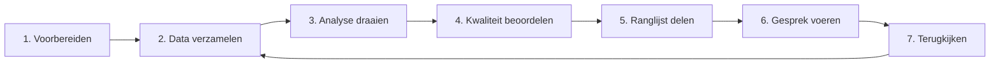

# Van data tot gesprek

De app is één onderdeel van een groter proces. Deze pagina zet de stappen op volgorde, van de voorbereiding binnen je instelling tot het gesprek met de student, en verwijst per stap naar de uitleg.

## 1. Voorbereiden binnen de instelling

Regel dit voordat je met studentgegevens werkt:

- een DPIA (Data Protection Impact Assessment);
- een ethische toetsing;
- een toetsing aan de AI-verordening;
- afspraken over wie de ranglijst ziet en wat er met een signaal gebeurt.

De [Datacoalitie Datagedreven Onderzoek](https://datagedrevenonderzoekmbo.nl/themas/voorspelmodel) beschrijft dit proces en heeft in een praktijkpilot [producten ontwikkeld](https://datagedrevenonderzoekmbo.nl/themas/voorspelmodel/praktijkpilot-de-uitnodigingsregel) die bij de invoering helpen.

## 2. Data verzamelen

Je hebt twee bestanden nodig: trainingsdata van eerdere cohorten en predictiedata van de huidige studenten. Beide komen uit je studentinformatiesysteem.

- Welke bestanden en kolommen nodig zijn: [Je data aanleveren](data-aanleveren.md).
- SQL-voorbeeldcode voor de export: [Uitnodigingsregel_datapreparatie](https://github.com/cedanl/Uitnodigingsregel_datapreparatie).
- Definities van de gebruikelijke variabelen: [data dictionary](Variabelen_Definities_v4.xlsx).

## 3. Analyse draaien

Installeer de app, kies je bestanden, bevestig de uitgangspunten en start de analyse. De app traint drie modellen en maakt per model een ranglijst. Alles draait op je eigen computer.

Uitleg: [Aan de slag](aan-de-slag.md).

## 4. Modelkwaliteit beoordelen

Maak in de app het rapport over modelkwaliteit voordat je een ranglijst gebruikt. Het rapport toetst de modellen op studenten die ze niet eerder hebben gezien en geeft een stoplicht: groen, geel of rood. Bij rood gebruik je de ranglijst niet.

Uitleg: [Resultaten lezen](resultaten-lezen.md#het-rapport).

## 5. Ranglijst delen

Download de ranglijst van het model dat het rapport aanbeveelt. Deel het bestand alleen met de begeleiders die de gesprekken voeren. Bepaal vooraf hoeveel studenten je uitnodigt; het rapport laat zien hoe de modellen presteren bij verschillende percentages.

Uitleg: [Resultaten lezen](resultaten-lezen.md#de-ranglijst).

## 6. Gesprek voeren

Een hoge plaats in de ranglijst is een reden om een student uit te nodigen. De ranglijst zegt niet waarom een student risico loopt en ook niet wat er in het gesprek moet gebeuren. Dat bepaalt de begeleider, samen met de student.

- Uitgangspunten voor het gebruik van de ranglijst: [Resultaten lezen](resultaten-lezen.md#uitgangspunten-bij-gebruik).
- Hulpmiddelen voor begeleiders en voor de invoering: de [producten uit de praktijkpilot](https://datagedrevenonderzoekmbo.nl/themas/voorspelmodel/praktijkpilot-de-uitnodigingsregel) van de Datacoalitie.

## 7. Terugkijken

Aan het eind van het studiejaar weet je welke studenten zijn uitgevallen. Voeg dat cohort toe aan de trainingsdata en draai de analyse voor het volgende cohort opnieuw. De app traint de modellen dan opnieuw. Maak ook het rapport opnieuw: de modelkwaliteit kan per jaar verschillen.
